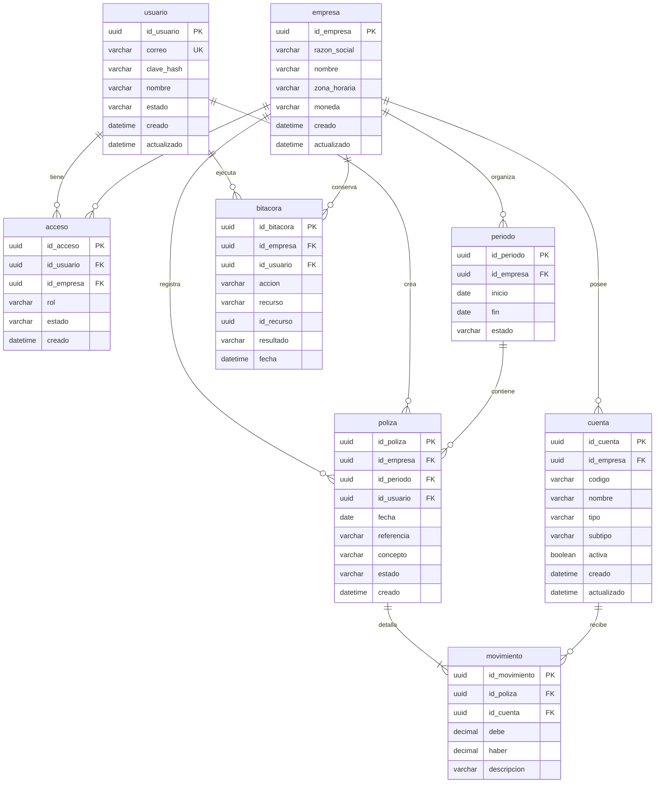

# Modelo entidad relación

## Diagrama lógico

`acceso` vincula a cada usuario con una empresa y su rol. Cada `movimiento` es una línea de una `poliza` y afecta una `cuenta`. `bitacora` conserva las acciones relevantes para auditoría. PK identifica la llave primaria, FK una llave foránea y UK un valor único.

## Restricciones de integridad

- `usuario.correo` es único después de normalizar mayúsculas y espacios.
- `acceso` tiene una restricción única para `id_usuario + id_empresa`.
- `cuenta` tiene una restricción única para `id_empresa + codigo`.
- Todas las relaciones contables deben pertenecer a la misma empresa; no basta con validar que los identificadores existan.
- `movimiento.debe` y `movimiento.haber` son decimales no negativos. Exactamente uno debe ser mayor que cero.
- La suma de débitos y créditos se valida en una transacción antes de publicar la póliza.
- Un `periodo` tiene `inicio <= fin`; periodos cerrados no admiten nuevas pólizas.
- `acceso.rol` usa los códigos de la matriz de permisos: `ADMIN` (administrador), `ACCOUNTANT` (contador) o `VIEWER` (consulta).
- `cuenta.tipo` usa los códigos previstos para activo (`ASSET`), pasivo (`LIABILITY`), capital (`EQUITY`), ingreso (`REVENUE`) o gasto (`EXPENSE`).
- Los reportes se calculan a partir de pólizas publicadas; no se persisten cifras derivadas como fuente de verdad.

## Correspondencia con el prototipo C++

| Prototipo | Modelo web |
| --- | --- |
| `Cuenta` y sus subclases | `cuenta` con tipo y subtipo validados |
| Acumulados `debe` y `haber` | `movimiento`, que conserva cada cargo y abono |
| `Contabilidad` | Servicios de pólizas y reportes limitados por empresa |
| `ArchivoManager` y archivo de texto | Repositorios sobre una base de datos relacional |
| Resumen financiero | Consultas de balance general y estado de resultados |

El diseño web conserva la idea contable del prototipo, pero evita guardar únicamente acumulados: cada movimiento debe quedar trazable.

## Implementación prevista en MySQL

- Se utilizará MySQL como motor relacional; la propuesta original que mencionaba MySQL o PostgreSQL queda como antecedente histórico.
- Los importes se implementarán con `DECIMAL`, con precisión y escala definidas en la migración, nunca con `FLOAT` o `DOUBLE`.
- Los identificadores UUID se almacenarán de forma consistente como `CHAR(36)` o `BINARY(16)`. La alternativa se cerrará antes de escribir la primera migración y no se mezclarán ambos formatos.
- Las tablas usarán un motor transaccional que permita claves foráneas y operaciones atómicas para publicar pólizas.
- Los campos de catálogo y estado tendrán restricciones en la aplicación y, cuando resulte apropiado, restricciones compatibles con la versión de MySQL adoptada.
- Los índices compuestos comenzarán por `id_empresa` en las consultas que aíslan datos por empresa.

La disponibilidad indicada por el equipo no se considera evidencia de configuración: la conexión, versión, usuario de aplicación y migraciones se comprobarán durante el Sprint 2.
