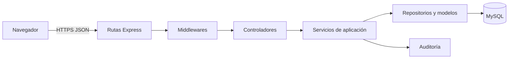

# Arquitectura propuesta

## Vista general



La interfaz web consume una API REST. Las rutas declaran endpoints; los middlewares atienden preocupaciones transversales; los controladores traducen HTTP; los servicios contienen reglas de negocio y transacciones; los repositorios concentran el acceso a datos.

## Organización prevista

```text
src/
  app.js
  config/
  routes/
    auth.routes.js
    memberships.routes.js
    accounts.routes.js
    journal-entries.routes.js
    reports.routes.js
  controllers/
  services/
  repositories/
  models/
  validators/
  middlewares/
    authenticate.js
    authorize.js
    company-context.js
    validate.js
    rate-limit.js
    error-handler.js
  utils/
tests/
  integration/
  e2e/
```

## Responsabilidades

| Capa | Sí debe hacer | No debe hacer |
| --- | --- | --- |
| Rutas | Declarar método, URL, middlewares y controlador. | Contener reglas contables o consultas SQL. |
| Middlewares | Autenticar, autorizar, establecer empresa, validar solicitud y manejar errores. | Calcular reportes o decidir reglas de pólizas. |
| Controladores | Leer solicitud, invocar un servicio y construir la respuesta HTTP. | Acceder directamente a la base o duplicar validaciones de negocio. |
| Servicios | Aplicar reglas, coordinar repositorios y controlar transacciones. | Depender de objetos específicos de Express. |
| Repositorios y modelos | Persistir y consultar datos con filtros por empresa. | Decidir permisos del usuario. |
| Validadores | Comprobar forma, tipos, límites y campos requeridos. | Sustituir autorización o integridad transaccional. |

## Endpoints iniciales

| Método y ruta | Propósito | Roles |
| --- | --- | --- |
| `POST /api/v1/auth/sessions` | Iniciar sesión. | Público |
| `DELETE /api/v1/auth/sessions/current` | Cerrar sesión. | Autenticado |
| `GET /api/v1/companies/:companyId/memberships` | Consultar integrantes. | ADMIN |
| `PATCH /api/v1/companies/:companyId/memberships/:id` | Cambiar rol o estado. | ADMIN |
| `GET /api/v1/companies/:companyId/accounts` | Consultar catálogo. | ADMIN, ACCOUNTANT, VIEWER |
| `POST /api/v1/companies/:companyId/accounts` | Crear cuenta. | ADMIN, ACCOUNTANT |
| `PATCH /api/v1/companies/:companyId/accounts/:id` | Actualizar o desactivar cuenta. | ADMIN, ACCOUNTANT |
| `POST /api/v1/companies/:companyId/journal-entries` | Crear póliza. | ADMIN, ACCOUNTANT |
| `GET /api/v1/companies/:companyId/accounts/:id/ledger` | Consultar mayor. | ADMIN, ACCOUNTANT, VIEWER |
| `GET /api/v1/companies/:companyId/reports/balance-sheet` | Generar balance general. | ADMIN, ACCOUNTANT, VIEWER |
| `GET /api/v1/companies/:companyId/reports/income-statement` | Generar estado de resultados. | ADMIN, ACCOUNTANT, VIEWER |
| `GET /api/v1/companies/:companyId/reports/monthly-trend` | Consultar tendencia. | ADMIN, ACCOUNTANT, VIEWER |

## Convenciones HTTP

- `200` para consultas o cambios exitosos, `201` para creación y `204` para cierre de sesión sin contenido.
- `400` para solicitud mal formada, `401` sin autenticación, `403` sin permiso, `404` cuando el recurso no es accesible, `409` para conflicto de unicidad y `422` para reglas de validación.
- Las respuestas de error tienen `code`, `message` y `requestId`; no incluyen trazas ni SQL.
- Todas las rutas se versionan bajo `/api/v1`.

## Decisiones registradas

| Decisión | Estado | Motivo |
| --- | --- | --- |
| Aplicación web con API REST | Aceptada | Coincide con la propuesta y la materia. |
| Node.js y Express.js | Aceptada | Está especificado en la propuesta. |
| MySQL como base de datos relacional | Aceptada | La propuesta admitía MySQL o PostgreSQL; el equipo eligió MySQL porque ya lo tiene disponible y posee experiencia previa en varios proyectos. |
| Pólizas con líneas en vez de acumulados editables | Aceptada | Mejora trazabilidad, integridad y auditoría respecto del prototipo. |
| Aislamiento por `id_empresa` | Aceptada | Previene acceso a datos ajenos y habilita múltiples empresas; coincide con la llave del modelo ER. |

La disponibilidad de MySQL proviene de la confirmación del equipo. Su instalación, versión y configuración todavía no se han verificado como parte de este avance documental.
